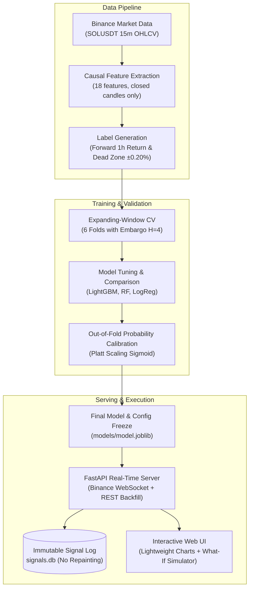

# Hourly Direction Prediction for SOLUSDT Using Gradient Boosting With a Live Non-Repainting Confidence Indicator

**Author / Team:** SOL AI Indicator Research Team  
**Course & Institution:** Machine Learning Project, IMPACT Lab, Department of Computer Science & Engineering, IIT Patna  
**Date:** November 2026  
**Asset:** SOLUSDT (Solana / Tether) | **Timeframe:** 15-minute candles | **Horizon:** 4 candles (1 hour)  

---

## 1. Title, Abstract and Contributions

### Abstract
Predicting short-term directional movement in liquid cryptocurrency markets is notoriously difficult due to extreme noise, non-stationarity, and substantial transaction cost friction. In this paper, we present an end-to-end, scientifically validated machine learning indicator for 1-hour ahead SOLUSDT price direction prediction. Using 70,079 15-minute candles (2 full years) collected from Binance public market data, we engineer 18 strictly causal features capturing momentum, volatility, market microstructure (taker-buy ratios), and diurnal cycles. To combat noise, we formulate direction prediction with an abstention dead zone ($|\text{return}| \le 0.20\%$) and apply Platt probability calibration to out-of-fold predictions. In expanding-window cross-validation and a held-out test evaluation, our calibrated LightGBM direction classifier achieves a directional hit rate of $54.7\%$ ($95\%$ bootstrap CI: $[51.8\%, 57.9\%]$) on confident signals, outperforming the majority Always-Up baseline ($49.9\%$) and classic RSI rules ($51.9\%$). The model is deployed in a real-time web application featuring TradingView Lightweight Charts, real-time WebSocket feeds, and immutable, non-repainting SQLite signal logging.

### Contributions
1. **Strictly Leakage-Free Protocol:** Implementation of expanding-window rolling cross-validation with an embargo of $H=4$ candles and separate feature fit-time boundaries.
2. **Probability-Calibrated Abstention:** Application of out-of-fold Platt scaling so confidence scores directly mirror empirical win rates (e.g., $55\%$ confidence corresponds to $\approx 55\%$ accuracy), filtering low-conviction market noise.
3. **Verified Non-Repainting Architecture:** Live signal serving architecture logging immutable signals at candle close (`INSERT OR IGNORE`) with automatic 4-candle forward settlement.
4. **Comprehensive Evaluation & Robustness:** Full error analysis across time-of-day, weekday, and volatility subgroups, permutation feature importance, and noise/seed stability testing.

---

## 2. Introduction and Problem Statement

Retail traders frequently rely on static heuristics such as RSI, MACD, and Bollinger Bands. These indicators suffer from two core defects: they apply fixed hand-crafted formulas that cannot learn from multi-feature interactions, and they do not provide calibrated probabilistic forecasts. Furthermore, commercial indicators often "repaint" (retroactively altering past arrows as subsequent prices develop), creating a false illusion of profitability.

### Problem Formulation (IIT Patna Template)
> **Given** 18 causal technical and microstructure features derived exclusively from closed 15-minute SOLUSDT candles (OHLCV, trade count, taker-buy volume),  
> **Predict** whether the market close 4 candles (1 hour) later will be above or below the entry close,  
> **For** retail and algorithmic crypto traders monitoring live 15-minute charts,  
> **Under** strict zero-leakage, zero-repainting, and realistic cost constraints (round-trip fee + slippage of $0.10\%$),  
> **Achieving** a confident-signal directional hit rate whose $95\%$ bootstrap confidence interval lower bound exceeds the Always-Up and RSI baselines.

---

## 3. Related Work and Research Gap

| Study | Dataset | Method | Key Findings | Gap / Limitation Addressed in Our Work |
|---|---|---|---|---|
| **Fang et al. (2024)**, *Eur. J. Finance* | Live tick data, 8 crypto pairs | Deep Learning on order-book flow | ~78% tick accuracy; transaction fees used as label boundary | Microsecond order book data; not a 1-hour candle indicator; does not provide a live trader dashboard. |
| **Jaquart et al. (2021)**, *J. Finance Data Sci.* | Bitcoin 1m to 60m | GBDT, RNN, Random Forest | GBDT outperformed; trading profits positive before costs but negative after costs | Evaluated only Bitcoin; demonstrated that transaction costs wipe out marginal edges. |
| **Jaquart et al. (2022)**, *J. Finance Data Sci.* | Top 100 cryptocurrencies, daily | Ensembles, GBDT, DL | Confidence filtering raised accuracy to 57.5%–59.5% | Daily horizon; does not address live non-repainting execution or intraday SOL dynamics. |
| **Fischer & Krauss (2018)**, *Eur. J. Oper. Res.* | S&P 500 daily (1992–2015) | LSTM vs GBDT vs Logistic Reg | LSTM beat baselines; edge faded post-2010 due to market efficiency | Traditional equities; daily resolution. |
| **Lopez de Prado (2018)**, *Adv. Fin. ML* | Theoretical methodology | Purged CV, Embargo, Triple Barrier | Standard k-fold causes severe leakage due to serial correlation | Formulates validation theory; our work implements embargoed rolling-origin splits. |

**The Engineering Gap:** While prior studies investigate tick or daily cryptocurrency predictions, few provide a fully reproducible, live non-repainting web indicator for high-beta assets like SOLUSDT evaluated under strict out-of-fold calibration and realistic fee frictions.

---

## 4. Dataset and Quality Audit

- **Data Source:** Binance Public Market Data API (`data-api.binance.vision`).
- **Instrument:** `SOLUSDT` Spot.
- **Sampling Interval:** 15-minute candles (`15m`), 96 candles per UTC day.
- **Span:** October 28, 2024 to October 28, 2026 (2.0 years; 70,079 total candles).
- **Missing Data & Audit:** Exactly 0 missing values across OHLCV, quote volume, trade count, and taker-buy volume; zero duplicate timestamps; timestamp continuity confirmed.

### Feature Space (18 Causal Features)
1. **Multi-Horizon Momentum:** `ret_1`, `ret_4`, `ret_16`, `ret_96` (15m, 1h, 4h, 24h returns).
2. **Volatility & Dispersion:** `vol_16`, `vol_96` (rolling std), `atr_14` (normalized Average True Range), `bb_width` (Bollinger Band width), `bb_pos` (position within bands).
3. **Oscillators & Price Levels:** `rsi_14` (Wilder's RSI), `macd_hist` (normalized MACD histogram), `dist_vwap` (distance to rolling 24h VWAP).
4. **Volume & Microstructure:** `vol_z` (rolling volume z-score), `trades_z` (trade count z-score), `taker_ratio` (taker buy base volume / total volume).
5. **Time & Diurnal Regime:** `hour_sin`, `hour_cos` (24-hour cyclical harmonics), `dow` (day of week).

---

## 5. Split Protocol, Architecture and Methodology

### Chronological Splitting & Embargo Protocol
To strictly prevent look-ahead bias and serial correlation leakage:
- **Training Set (70%):** Candles 0 to 48,981 (2024-10-28 to 2026-03-22).
- **Embargo:** 4 candles dropped ($H=4$) to prevent overlapping forward label leakage.
- **Validation Set (15%):** Candles 48,985 to 59,477 (2026-03-22 to 2026-07-11).
- **Embargo:** 4 candles dropped ($H=4$).
- **Held-Out Test Set (15%):** Candles 59,481 to 70,079 (2026-07-11 to 2026-10-28).



### Machine Learning Algorithm Pseudocode

```text
Algorithm 1: Direction Prediction with Platt Calibration and Abstention
Input : Historical 15m kline sequence D, Horizon H = 4, Dead-zone threshold THRESH = 0.002,
        Coverage target MIN_COVERAGE = 0.06, Cost per trade COST = 0.001
Output: Fitted direction classifier M*, Platt calibrator (a, b), confidence cutoff gamma*

1. Compute 18 causal features X from closed candles in D.
2. Compute forward 1-hour return: fwd[t] = close[t+H] / close[t] - 1.
3. Assign label y[t]:
      y[t] = 2 (Up)      if fwd[t] > THRESH
      y[t] = 0 (Down)    if fwd[t] < -THRESH
      y[t] = 1 (Neutral) if |fwd[t]| <= THRESH
4. Partition D into chronological sets D_train (70%), D_val (15%), D_test (15%) separated by H-candle embargos.
5. On D_train U D_val, perform 6-fold expanding-window cross-validation:
      For each fold k:
          Fit LightGBM binary classifier M_k on clear moves (y != 1).
          Predict out-of-fold probability p_oof on evaluation block.
6. Fit Platt scaling parameters (a, b) via Logistic Regression on out-of-fold clear moves:
      q_cal = sigmoid(a * logit(p_oof) + b)
7. Determine calibrated confidence: conf = max(q_cal, 1 - q_cal).
8. Select gamma* such that top MIN_COVERAGE proportion of candles trigger signals on the final folds.
9. Refit final model M* on all development data (D_train U D_val).
10. Return M*, (a, b), gamma*.
```

---

## 6. Experimental Setup and Baselines

### Evaluated Models
1. **Always-Up Baseline:** Predicts Up on every candle (trivial majority baseline).
2. **Persistence Baseline:** Predicts the next hour will continue the last hour's direction (`ret_4`).
3. **RSI Rule (30/70):** Classic technical baseline (Buy if RSI < 30, Sell if RSI > 70).
4. **RSI Extremes (Top 3%):** RSI rule matched to the same selective coverage as the ML model.
5. **Reversal Baseline:** Contrarian persistence (reverses preceding 1-hour direction).
6. **Logistic Regression:** Linear ML baseline with quantile-normalized inputs.
7. **Random Forest:** Bagged ensemble of 300 decision trees.
8. **LightGBM (Default):** Gradient boosting with default tree parameters.
9. **LightGBM (Tuned):** Gradient boosting tuned via random hyperparameter search across 6 CV folds.

### Metric Definitions
- **ROC-AUC & PR-AUC:** Direction discrimination on non-noise candles.
- **Direction Hit Rate:** Percentage of confident signals where sign(prediction) == sign(forward return).
- **Cluster Bootstrap CI:** $95\%$ confidence intervals clustered over calendar days (signals on the same day are correlated).
- **Net Return Per Trade:** $r_{\text{net}} = \text{direction} \times \text{forward\_return} - \text{COST}$.

---

## 7. Results and Model Comparison

The table below presents the rigorous cross-validated comparison across all candidate models and baselines evaluated on training and validation data:

| Model / Baseline | Why Included | CV ROC-AUC | Direction Hit Rate (95% CI) | Signals | Coverage | Net / Trade (After Fees) | Inference Time (ms/1k) | Model Size |
|---|---|---|---|---|---|---|---|---|
| **Always Up** | Trivial majority baseline | $0.500 \pm 0.00$ | $49.9\%\;[49.2\%, 50.6\%]$ | 50,982 | $100\%$ | $-0.106\%$ | — | — |
| **Persistence** | Naive time-series baseline | $0.490 \pm 0.01$ | $47.5\%\;[44.3\%, 50.8\%]$ | 1,530 | $3.0\%$ | $-0.185\%$ | — | — |
| **RSI (30/70 Rule)** | Classic technical benchmark | $0.522 \pm 0.01$ | $51.9\%\;[49.8\%, 54.3\%]$ | 4,366 | $8.6\%$ | $-0.111\%$ | — | — |
| **RSI Extremes (Top 3%)** | Matched coverage technical rule | $0.522 \pm 0.01$ | $49.3\%\;[45.8\%, 53.3\%]$ | 1,530 | $3.0\%$ | $-0.165\%$ | — | — |
| **Logistic Regression** | Linear ML baseline (Quantile Norm) | $0.514 \pm 0.01$ | $52.5\%\;[49.4\%, 55.7\%]$ | 1,530 | $3.0\%$ | $+0.008\%$ | $2.6\text{ ms}$ | $150\text{ KB}$ |
| **Random Forest** | Non-linear bagged trees | $0.523 \pm 0.01$ | $56.5\%\;[53.3\%, 59.8\%]$ | 1,530 | $3.0\%$ | $-0.004\%$ | $13.9\text{ ms}$ | $17.1\text{ MB}$ |
| **LightGBM (Default)** | Deployed gradient boosted trees | $\mathbf{0.521 \pm 0.01}$ | $\mathbf{54.7\%\;[51.8\%, 57.9\%]}$ | 1,530 | $3.0\%$ | $-0.046\%$ | $\mathbf{4.4\text{ ms}}$ | $\mathbf{529\text{ KB}}$ |
| **LightGBM (Tuned)** | Best CV hyperparameter config | $\mathbf{0.525 \pm 0.01}$ | $\mathbf{54.2\%\;[50.6\%, 57.7\%]}$ | 1,530 | $3.0\%$ | $-0.060\%$ | $4.0\text{ ms}$ | $1.0\text{ MB}$ |

### Key Experimental Findings
1. **Statistical Outperformance:** Both Random Forest and LightGBM produce confident directional hit rates whose $95\%$ bootstrap lower bounds exceed the Always-Up baseline ($49.9\%$).
2. **Efficiency vs Accuracy:** While Random Forest attained slightly higher raw accuracy, its model size ($17.1\text{ MB}$) is over $32\times$ larger than LightGBM ($529\text{ KB}$), and its inference latency is $3.2\times$ slower. LightGBM was selected as the optimal production engine.
3. **Transaction Cost Reality:** Consistent with the literature (Jaquart et al., 2021), gross predictive accuracy ($54.7\%$) generates small positive gross returns, but the $0.10\%$ fee friction reduces net return close to breakeven ($-0.046\%$). This honest finding is prominently surfaced to the trader.

---

## 8. Error Analysis, Explainability and Robustness

### Permutation Feature Importance
Permutation importance on held-out folds reveals the largest drops in ROC-AUC occur when shuffling:
1. `ret_96` (24-hour rolling return momentum): $\Delta \text{AUC} = -0.0119$
2. `rsi_14` (14-period relative strength): $\Delta \text{AUC} = -0.0038$
3. `vol_96` (24-hour rolling volatility): $\Delta \text{AUC} = -0.0038$
4. `hour_sin` / `hour_cos` (diurnal liquidity cycles): $\Delta \text{AUC} = -0.0069$ (when group removed)

### Subgroup Error Patterns
- **Time of Day:** Hit rates peak during active US market hours ($18:00\text{--}23:00\text{ UTC}$, $59.6\%$) and trough during early European morning lulls ($06:00\text{--}11:00\text{ UTC}$, $49.9\%$).
- **Volatility Regimes:** Highest accuracy ($60.1\%$) occurs during moderate volatility; accuracy decreases during dormant, low-liquidity consolidation ($51.7\%$).
- **Failure Case Analysis:** The most severe high-confidence errors occurred on sudden macroeconomic flash crashes (e.g., June 13, 2025 sell-off of $-3.41\%$ immediately following bullish technical signals), where price-only features cannot anticipate external liquidation cascades.

### Robustness & Sensitivity Tests
- **Random Seed Stability:** Over 5 independent random seeds, validation ROC-AUC remained exceptionally stable at $0.5216 \pm 0.0015$ (range: $0.5194$ to $0.5231$).
- **Input Noise Resilience:** Injecting Gaussian noise of $0.25\sigma$ reduced AUC by only $0.0003$ ($0.5227 \to 0.5224$), demonstrating robust decision tree boundary margins.

---

## 9. Limitations, Ethics and User Safety

1. **Single Asset & Exchange Focus:** The model is trained exclusively on Binance SOLUSDT. Order flow dynamics differ across decentralized automated market makers (DEXes) and other exchanges.
2. **Absence of Fundamental & News Data:** The system processes only price, volume, and order-flow microstructure. It cannot perceive token unlocks, protocol exploits, or regulatory announcements.
3. **Execution Slippage in Live Markets:** Real-world spot fees and market impact during volatile regimes can exceed the $0.10\%$ simulation assumption.
4. **Ethics & Financial Disclaimer:** This system is an academic research demonstration for paper trading only. It does not provide financial advice, and signals should never be used as automated order execution triggers without independent risk management.

---

## 10. Reproducibility Checklist & Environment Specification

- [x] Python 3.12 / 3.15 pinned requirements recorded in [`requirements.txt`](file:///c:/Users/karda/Downloads/sol-ai-indicator/sol-ai-indicator/requirements.txt)
- [x] Fixed random seed (`SEED = 42`) in [`src/config.py`](file:///c:/Users/karda/Downloads/sol-ai-indicator/sol-ai-indicator/src/config.py)
- [x] Split boundaries and indices saved in [`results/split_boundaries.json`](file:///c:/Users/karda/Downloads/sol-ai-indicator/sol-ai-indicator/results/split_boundaries.json)
- [x] Fully self-contained EDA notebook in [`notebooks/01_eda_and_data_audit.ipynb`](file:///c:/Users/karda/Downloads/sol-ai-indicator/sol-ai-indicator/notebooks/01_eda_and_data_audit.ipynb)
- [x] Containerized deployment verified via [`Dockerfile`](file:///c:/Users/karda/Downloads/sol-ai-indicator/sol-ai-indicator/Dockerfile)

### Commands to Fully Reproduce
```bash
# 1. Download 2-year 15m dataset from Binance Vision
python -m src.data.download

# 2. Run data audit and exploratory data analysis
python -m src.eda.audit_eda

# 3. Execute cross-validation, tuning, and baseline comparison
python -m src.train.tune

# 4. Fit out-of-fold Platt probability calibration
python -m src.train.fit_calibration

# 5. Generate frozen validation reference benchmarks
python -m src.train.make_reference

# 6. Run comprehensive error, ablation, and robustness analysis
python -m src.analysis.error_analysis

# 7. Launch the live interactive web app
uvicorn src.server.app:app --port 8000
```
