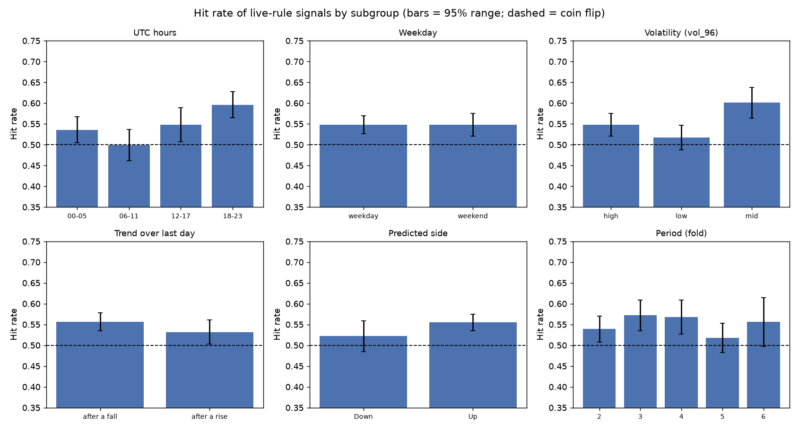
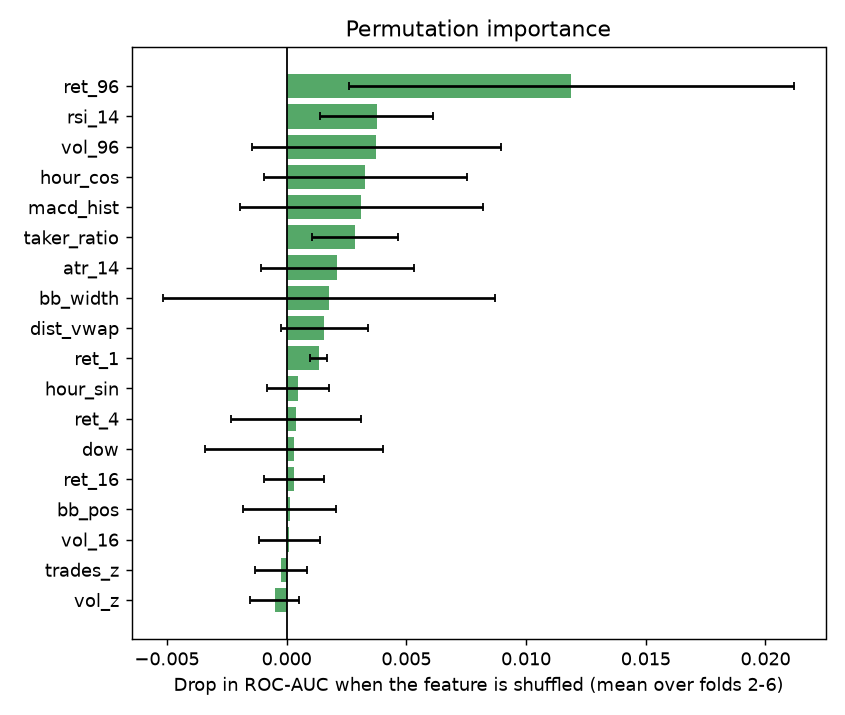
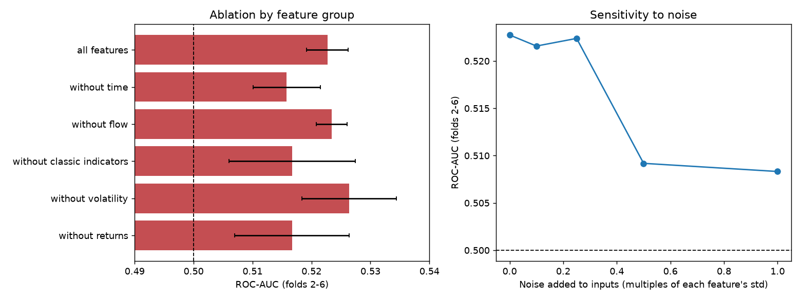

# Error analysis and robustness (training + validation data only)

Generated by `python -m src.analysis.error_analysis`.

## Errors by subgroup

- Live-rule signals analysed: 3,215; overall hit rate 0.548
- UTC hours: lowest 06-11 (0.499, n=705), highest 18-23 (0.596, n=977)
- Weekday: lowest weekday (0.548, n=2028), highest weekday (0.548, n=2028)
- Volatility (vol_96): lowest low (0.517, n=1173), highest mid (0.601, n=687)
- Trend over last day: lowest after a rise (0.532, n=1040), highest after a fall (0.556, n=2175)
- Predicted side: lowest Down (0.522, n=671), highest Up (0.555, n=2544)
- Period (fold): lowest 5 (0.518, n=743), highest 3 (0.572, n=710)
- With six groups and several levels, extremes are partly chance; only gaps clearly larger than the bars are worth acting on.

**Interpretation (write 1-2 sentences):** _TODO_

## Representative cases and confusion

Confusion matrix (clear moves only, signals):

| row_0 | actual Down | actual Up |
|---|---|---|
| predicted Down | 262 | 242 |
| predicted Up | 766 | 974 |

Share of signals followed by a Neutral move (inside +/-0.20%): 30.2%

Most confident CORRECT signals:

| time | direction | confidence | move |
|---|---|---|---|
| 2025-10-13 01:45 | Down | 0.593 | -1.48% |
| 2026-02-06 22:30 | Down | 0.584 | -1.68% |
| 2026-02-05 16:00 | Up | 0.583 | 0.29% |
| 2025-08-13 10:45 | Down | 0.583 | -0.25% |
| 2025-06-05 20:30 | Up | 0.581 | 1.43% |

Most confident WRONG signals:

| time | direction | confidence | move |
|---|---|---|---|
| 2025-06-13 01:00 | Up | 0.598 | -0.29% |
| 2025-06-13 00:15 | Up | 0.596 | -1.43% |
| 2025-05-30 23:00 | Up | 0.586 | -0.38% |
| 2025-08-13 01:15 | Down | 0.582 | 0.16% |
| 2025-06-13 00:00 | Up | 0.581 | -3.41% |

**Interpretation (write 1-2 sentences):** _TODO_

## Permutation importance

Baseline ROC-AUC (folds 2-6): 0.5227. Largest drops: ret_96 (0.0119); rsi_14 (0.0038); vol_96 (0.0038).

Caution: correlated features share credit (for example vol_16 and atr_14), so single-feature drops understate their importance; and importance is not causation.

**Interpretation (write 1-2 sentences):** _TODO_

## Ablation, seed and noise robustness

| variant | auc_mean | auc_std | delta_vs_all |
|---|---|---|---|
| all features | 0.5227 | 0.0035 | 0.0 |
| without time | 0.5158 | 0.0057 | -0.0069 |
| without flow | 0.5234 | 0.0026 | 0.0007 |
| without classic indicators | 0.5167 | 0.0107 | -0.006 |
| without volatility | 0.5264 | 0.008 | 0.0037 |
| without returns | 0.5167 | 0.0097 | -0.006 |

Largest AUC loss when removing a group: without time (-0.0069).

Random seed: ROC-AUC 0.5216 +/- 0.0015 over 5 seeds (range 0.5194 to 0.5231).

Noise: ROC-AUC 0.5227 with clean inputs, 0.5224 at 0.25 std of noise, 0.5083 at 1.0 std.

**Interpretation (write 1-2 sentences):** _TODO_
