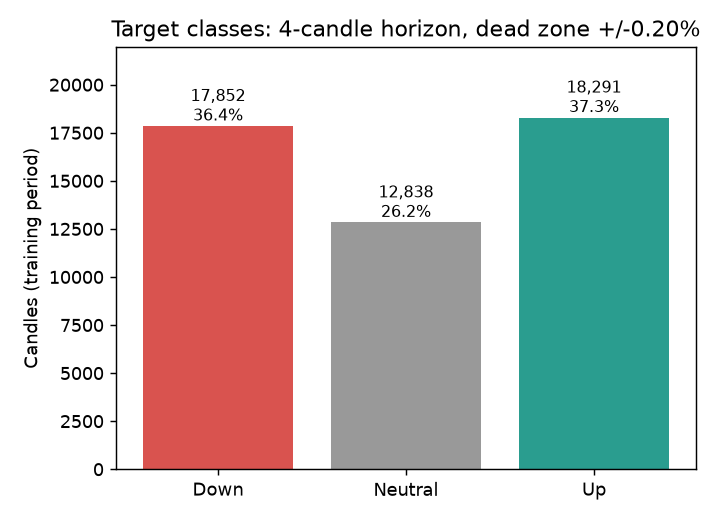
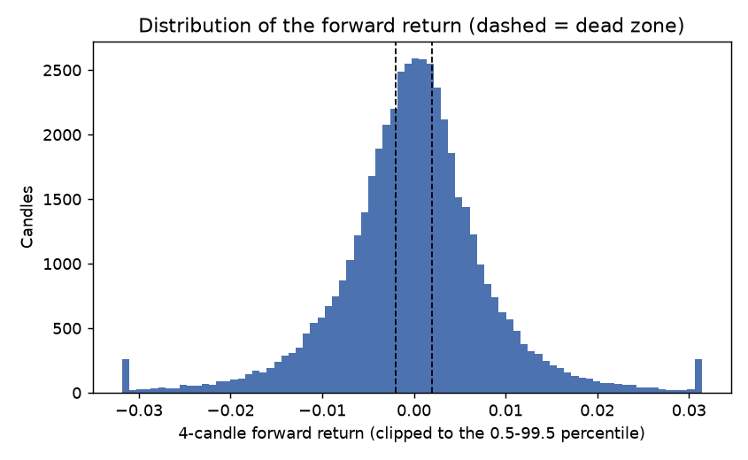
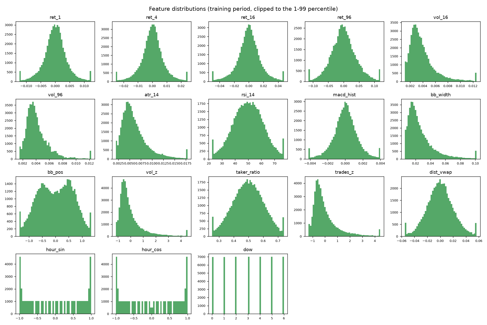
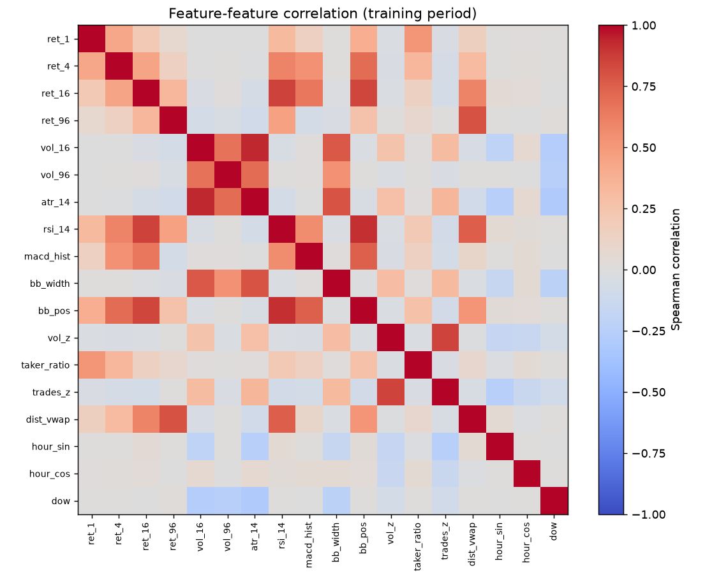
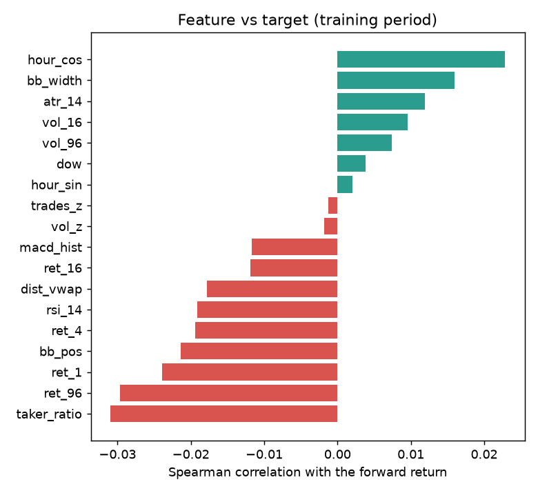
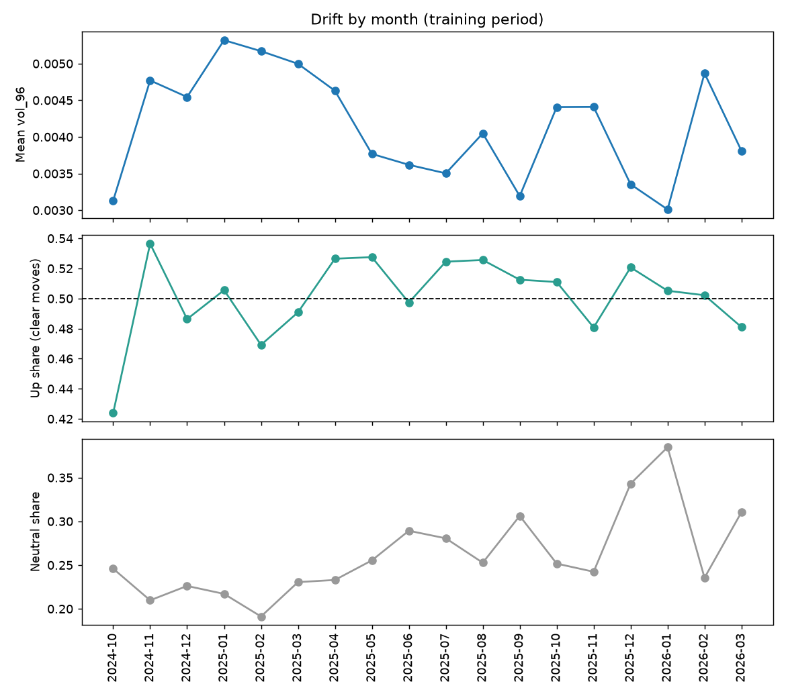
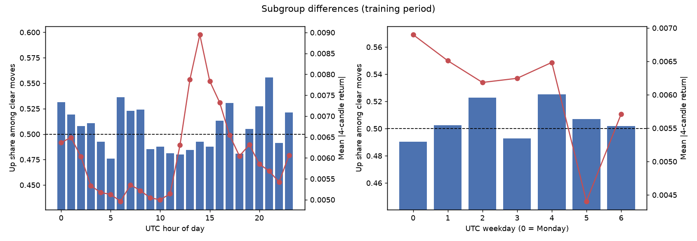

# EDA report (training period only)

Generated by `python -m src.eda.audit_eda`. Validation and test periods were not analysed.

## Target class counts

- Training candles analysed: 48,981
- Share per class: Down 36.4%, Neutral 26.2%, Up 37.3%
- Clear moves (Up or Down): 73.8% of candles; Up share among them: 0.506 (this is the 'always Up' direction baseline)

**Interpretation (write 1-2 sentences after viewing the figure):** _TODO_

## Forward return distribution

- Mean -0.0016%, std 0.9018%, skew 0.30, excess kurtosis 16.81
- Inside the dead zone (Neutral): 26.2%; 0.5th / 99.5th percentile: -3.187% / +3.140%

**Interpretation (write 1-2 sentences after viewing the figure):** _TODO_

## Feature distributions

- Features analysed: 18; features with |skew| > 2 (heavy tails): vol_16, vol_96, atr_14, bb_width, vol_z, trades_z
- Tree models need no scaling; the logistic-regression baseline standardises features inside the pipeline.

**Interpretation (write 1-2 sentences after viewing the figure):** _TODO_

## Feature correlations (redundancy)

- Most correlated pairs: vol_16 and atr_14 (+0.93); rsi_14 and bb_pos (+0.91); ret_16 and rsi_14 (+0.86); vol_z and trades_z (+0.85); ret_16 and bb_pos (+0.84)

**Interpretation (write 1-2 sentences after viewing the figure):** _TODO_

## Feature vs target relationship

- Strongest: taker_ratio (-0.031); median |correlation| 0.014
- Values near zero are expected for short-horizon returns; a tree model can still use non-linear structure. Correlation is not causation.

**Interpretation (write 1-2 sentences after viewing the figure):** _TODO_

## Drift over time

- Months covered: 18; mean vol_96 ranges 0.0030 to 0.0053
- Up share among clear moves ranges 0.424 to 0.536 (0.5 = balanced)
- Neutral share ranges 0.191 to 0.385
- Changing volatility or balance across months means the market regime shifts; this limits how far results generalise.

**Interpretation (write 1-2 sentences after viewing the figure):** _TODO_

## Subgroup differences by time

- By UTC hour of day: highest Up share 21 (0.556), lowest 5 (0.476); smallest group has 1,396 clear moves (standard error about 0.013); most volatile group 14
- By UTC weekday (0 = Monday): highest Up share 4 (0.525), lowest 0 (0.490); smallest group has 4,562 clear moves (standard error about 0.007); most volatile group 0
- Differences smaller than about two standard errors are likely noise.

**Interpretation (write 1-2 sentences after viewing the figure):** _TODO_
